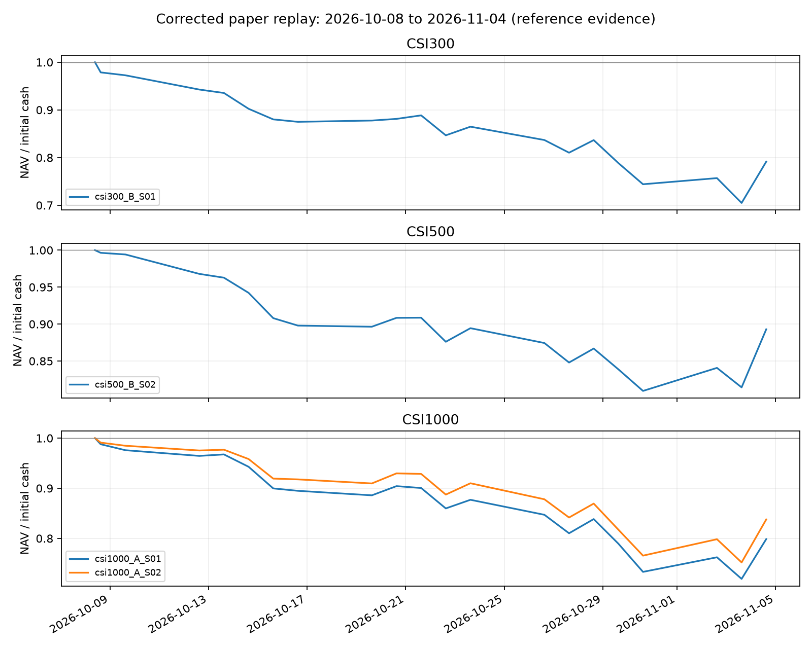

# 下周使用前的策略复验、候选重排与运行验收（2026-11-06）

状态：`RESEARCH_COMPLETED / OPERATIONAL_ACCEPTANCE_PENDING / NOT_LIVE_APPROVED`。依据[已批准方案](2026-11-06-prelive-revalidation-plan.md)、[结果产生前的执行登记](2026-11-06-prelive-execution-register.json)及用户追加回填要求的[独立登记](2026-11-06-october-backfill-register.json)执行。已完成 **72 个长历史/成本/相位场景、4 个近期账户回填**；未切换策略、部署生产、覆盖正式账户或发送实盘订单。

后续[四项复审修复](2026-11-06-review-followup-fixes.md)已完成：最终全量回归 836 passed，新增 9 个 smoke 场景与原回放前缀一致，显式重读本报告的 72 个历史场景后指标及决策不变。本文下方 806 项测试及旧源码清单保留为原复验阶段的记录，正式部署应绑定后续修复版本。

结论：三市场均保留现任作为后续有限使用审核的候选，现有证据不支持立即更换。CSI1000 Top20 在长历史中优于现任，但 2025–2026/09 尾段优势反转，不满足预先登记的替换条件。近期三个现任均亏损，不能把“没有合格替代者”解释为现任已获实盘准入或已证明最佳。

## 1. 用户确认的使用合同

- CSI300、CSI500、CSI1000 三个独立账户，每账户 1,000,000 元；不共用现金或合并净值。
- 实盘由用户人工查看信号后下单；模拟账户允许自动执行，不代表授权连接券商自动下单。
- 用户要求从 **2026-10-08** 首笔执行开始回填，模拟账户按独立 1M 初始现金重建；前一信号日是 2026-09-30。历史模拟持仓不能覆盖券商实际持仓，也不能把模拟增量调仓直接当作空仓实盘的首次建仓。
- 用户明确要求**不限制每账户最大回撤与单股仓位比例**。使用包以显式关闭标志表示，不再将这两项当成缺失输入阻断。仍检查现金不透支、交易合法性、数据日期、状态一致性和账本守恒；不自行新增人工风控阈值。

## 2. 已完成的输入冻结与 smoke

1. 长历史择优复用三市场 2018–2024 冻结信号和现任信号脊柱至 2026-09-30 的扩展，不新增模型训练或超参搜索。每份预测均绑定登记的 SHA，重叠日期要求股票集合和分数逐行完全一致。用户追加的 10/08 起回填另行登记，按现任固定参数做历史截止日训练，见第 6.1 节。
2. 在完整行情中选取共 **12,556 个文件**，记录价格、factor、volume、日历和成分文件指纹。另一个较新日期的本地目录是部分下载：CSI300/500/1000 分别缺 2,140 / 4,232 / 8,900 个所需字段文件。该目录被排除，不能把它产生的拒单、高现金比例或低收益当成策略结论。
3. 三个现任各一个月、三种成本情景的本地 smoke 均通过。云端使用用户指定的授权 workspace，前台执行；生产镜像构建、扩展导入、读取原有预测、独立研究卷读写与 commit 的最终 smoke 已通过。
4. 云端源卷行情只到 **2026-09-30**，且没有当前 production paper state。因此，云端导入 smoke 不能证明当前线上账户迁移或最新每日任务已验收。
5. 最初的云端批量数据准备出现多次心跳超时，其中一次记录了 worker `SIGSEGV` 和平台重启；根因未确认。已停止相应临时应用，撤下失败的批量云回放实现。长历史研究改用本地两个有界进程，环境入口 `prelive_modal.py` 仅保留有时限的 smoke。随后新增的 `october_backfill_modal.py` 从公开发行包下载到容器临时盘，避免源卷批量 I/O；独立 smoke 和三市场训练已成功，实际前台退出码均为 0。

本地历史行情包上传曾被自动审批拒绝，未实际上传。长历史改用本地计算；近期云训练读取已固定 SHA 的公开发行包，没有通过其他路径绕过本地数据上传拒绝，也没有改动源卷。

### 本轮新增的数据与使用问题

| 编号 | 已验证事实 | 处理与边界 |
|---|---|---|
| V01 | 较新的本地行情目录是部分股票下载，缺文件会造成虚假的高现金和大量拒单 | 增加回放输入完整性检查，排除该目录 |
| V02 | 多份本地 provider 的 CSI1000 基准在 2025-04-16 缺收盘价；旧扩展报告将该日和次日基准收益记为 0 | 严格基准检查先阻断；从官方取得缺日与相邻报价，在独立数据版本仅修复一个基准 close 浮点值，原数据及全部股票字段不变 |
| V03 | 用户要求从 10/08 重建模拟，既有账户已经持仓 | 独立版本回填，首次实盘建仓按真实账户核对，不覆盖旧模拟或真实持仓 |
| V04 | TopK/DropN 持有期权重会漂移，0.95 风险参数不是每日总仓位上限 | 输出实际单股权重和现金占比；按用户选择不设回撤/单股上限，未静默改变策略 |

V02 的[中证指数公司原始接口](https://www.csindex.com.cn/csindex-home/perf/index-perf?indexCode=000852&startDate=20250414&endDate=20250418)返回目标日原始收盘 **5835.35**；同时校验前后交易日原始价格与 provider 的 close/factor 相差不超过 0.01 指数点。使用该日已有的有效 factor 转回 provider 坐标，只更换独立版本中的基准 close 文件。新增 `benchmark_evidence_overlay.py` 拒绝修改已有有效报价、错误指数、重复日期、相邻价格不符或来源 SHA 不符。修补窗口 smoke 覆盖缺日和次日，缺口恢复前的失败记录保留；不会通过填 0 或删除交易日来消除失败。

## 3. 执行与数值验证

回放调用生产 `PaperPortfolio`，统一 T 收盘信号到下一交易日开盘、各市场标签与 TopK/DropN、5bp 买 / 15bp 卖、最低 5 元及修正后的板块数量和限价规则。额外 0 / 5 / 10bp 通过真实账户重新执行和扣费，不是直接从旧 CAGR 减数值。额外费用仍是敏感性模型，不等同于已校准的市场冲击。

为了加速，独立回放将历史账本保存在外部日记录中，不让每次失败回滚反复复制过去 120 日日志。生产账户的持久化历史逻辑没有修改。两候选 × 三成本情景共 **6 个 1,698 日完整回放**已核对：精简前后所有日频净值、现金、费用、逐笔订单和解析后的完整账本完全一致。参数 `0` 与 `0.0` 的 JSON 文本表现不同，不被描述为文件 SHA 相同。

独立校验逐日检查现金、库存、费用及净值守恒和新买入板块数量；卖出使用共享的数量上限实现。能够用完整实际开闭盘报价核对的日期另做强账本校验。缺历史 ST、开盘流动性或停牌来源时保持 **REFERENCE_ONLY**，不把缺行情自动认证为停牌，也不把参考承接估值当成已验证估值。缺报价明细保留到各场景 `gaps.json`。真实账户的物理库存及公司行为仍应以券商记录核对，不用 Qlib 复权单位替代券商持仓。

## 4. 主窗口结果

主窗口为 2018-01-03–2024-12-31，共 1,698 个执行交易日，初始资金均为 1M。排序按登记的净 Sharpe、回撤、CAGR 和候选 ID；这是已消费历史的纠错比较，不是新 OOS。

| 市场 / 候选 | 现任 | CAGR | 最大回撤 | 净 Sharpe | 额外 10bp CAGR |
|---|---|---:|---:|---:|---:|
| csi1000_A_S02 | 否 | 20.85% | -39.51% | 0.858 | 15.43% |
| csi1000_A_S01 | 是 | 14.61% | -52.85% | 0.617 | 11.13% |
| csi300_B_S02 | 否 | 10.59% | -40.72% | 0.544 | 5.35% |
| csi300_B_S01 | 是 | 10.87% | -50.64% | 0.518 | 6.56% |
| csi300_A_S01 | 否 | 7.50% | -55.13% | 0.408 | 2.47% |
| csi300_A_S02 | 否 | 5.81% | -46.68% | 0.358 | 0.95% |
| csi500_B_S02 | 是 | 4.31% | -42.97% | 0.297 | -0.48% |
| csi500_B_S01 | 否 | 1.22% | -48.17% | 0.171 | -0.19% |
| csi500_A_S01 | 否 | -1.59% | -43.57% | 0.065 | -6.68% |
| csi500_A_S02 | 否 | -1.59% | -37.60% | 0.047 | -3.96% |

旧 1M 研究以 Qlib 研究执行器回放为主，本次采用生产 paper 引擎；差异包含规则修复与执行路径差异。在逐项归因完成前，不把全部变化归因于某一个修复项。

## 5. 扩展区间、成本与相位

扩展完整路径覆盖 2018-01-03–2026-09-30，共 2,122 个执行日；尾段为 2025-01-02–2026-09-30：

| 候选 | 全段 CAGR | 全段最大回撤 | 全段 Sharpe | 尾段净收益 | 尾段 Sharpe |
|---|---:|---:|---:|---:|---:|
| csi300_B_S01（现任） | 12.02% | -50.64% | 0.563 | 31.05% | 0.772 |
| csi300_B_S02 | 11.95% | -40.72% | 0.609 | 32.67% | 0.945 |
| csi500_B_S02（现任） | 7.81% | -42.97% | 0.450 | 43.72% | 1.169 |
| csi500_B_S01 | 4.30% | -48.17% | 0.292 | 32.81% | 0.878 |
| csi1000_A_S01（现任） | 18.62% | -52.85% | 0.749 | 71.40% | 1.362 |
| csi1000_A_S02 | 21.90% | -39.51% | 0.906 | 50.15% | 1.129 |

**V05：已修正汇总器的扩展检查口径。** 初版用“2018–2026 全段 Sharpe”检查“扩展尾段不能反转”，会被早期优势掩盖。现改为仅使用主窗口结束后的连续账户尾段，读取原报告并核对 SHA，以 2024-12-31 的实际 NAV 为期初值。新增测试覆盖尾段走弱拒绝替换、期初 NAV 沿用与报告篡改拒绝。原逐笔回放无需重跑；初版汇总保存在证据目录 `withdrawn-analysis/` 并明确撤回，正式结论以 `final-analysis.json` 为准。

CSI1000 四相位统一执行区间为 2018-01-24–2024-12-31，共 1,683 日：

| 相位 | Top10 CAGR / 最大回撤 / Sharpe | Top20 CAGR / 最大回撤 / Sharpe | Top20 净收益较高 |
|---|---:|---:|---|
| 00 | 15.14% / -53.02% / 0.632 | 20.59% / -39.54% / 0.850 | 是 |
| 04 | 10.40% / -42.37% / 0.483 | 13.83% / -45.07% / 0.624 | 是 |
| 06 | 12.22% / -41.43% / 0.542 | 11.18% / -43.61% / 0.538 | 否 |
| 15 | 16.32% / -41.38% / 0.665 | 18.00% / -43.39% / 0.767 | 是 |

Top20 赢得 3/4 相位和主窗口 5/7 年，额外 10bp 成本下仍较好；相位 06 较弱，且尾段 Sharpe 反转，因此未通过全部登记条件。72 个场景是同一批候选的区间与敏感性复验，不是 72 个独立策略或独立统计证据。

扩展区间连续使用 2018 年建立的同一账户路径，不在 2025 年重置 1M，不把尾段收益拼成跨账户曲线。尾段指标的期初值应使用上一执行日的真实 NAV。CSI1000 相位比较统一从 2018-01-23 信号开始，新建同额账户，避免不同开始日期或不同已有持仓污染比较。

## 6. 每市场结论

| 市场 | 研究结论 | 原因 | 生产动作 |
|---|---|---|---|
| CSI300 | 保留现任为待审核候选 | 同脊柱 Top20 回撤较小，但主窗口 CAGR 略低、Sharpe 改善不足 0.1、10bp 压力下较弱，且缺相位支持 | 不切换 |
| CSI500 | 保留现任为待审核候选 | 现任在已登记候选中主窗口排名第一，扩展尾段也优于同脊柱 Top10；额外 10bp 下主窗口 CAGR 降为 -0.48%，成本敏感性仍需关注 | 不切换 |
| CSI1000 | 保留现任；Top20 留在研究对照中 | Top20 长历史更好，但 2025–2026/09 尾段 Sharpe 1.129 低于现任 1.362，违反预登记的尾段不能反转条件 | 不切换 |

当前所有历史比较都保留 ST、流动性及部分停牌证据限制。策略保留或替换的研究建议，与允许在某个交易日实盘使用的判断分别记录；不会自动改 canonical profile 或降低 120 日研究晋级门禁。

### 6.1 用户要求的 10/08 起回填

使用[公开行情发行包](https://github.com/chenditc/investment_data/releases/tag/2026-11-04)，发行时间 2026-11-04 15:58:24 UTC，570,637,931 字节，SHA256 为 `dc917293925635189e982f47d35b960c3db8a9c3f11312c937673c8afdec21aa`。本次固定的数据版本到 **2026-11-04**，不虚构 11/05 及以后的行情或净值。

三市场均按现任模型固定参数、生产标签成熟度/purge/验证窗口和 20 日重训逻辑重建信号；实际训练截止点为 **2026-09-30、2026-10-26**。9/30 信号在 10/08 首次执行。云任务每市场 20 CPU、32 GiB，最多三市场并行；先做 CSI300 smoke，再前台执行完整任务。CSI300 两次独立训练预测 SHA 完全相同，单日与整段预测首日分数逐项相等。完整任务 app `ap-jIDOICZ7fDxkYI0Z8EZEGw` 正常退出，三市场 wall time 约 58 / 170 / 244 秒，峰值内存约 6.3 / 10.5 / 17.5 GiB；CSI300 复用了已通过的首块 smoke。全部六个训练区块的截止日、配置与预测 SHA 已归档。

这是**使用当前行情版本、按历史模型截止日重建的模拟回填**，不是当时实际留存的实时信号，也不能认证行情历史修订、当时 ST 或竞价流动性。CSI1000 Top20 仅作独立研究账户，使用相同预测，未注册为新 canonical。

| 账户 | 20 日净收益 | 期末净值（元） | 最大回撤 | 累计费用（元） |
|---|---:|---:|---:|---:|
| CSI300 现任 Top10/Drop1 | -20.84% | 791,553.40 | -29.52% | 4,089.78 |
| CSI500 现任 Top20/Drop2 | -10.70% | 892,974.24 | -19.04% | 3,741.62 |
| CSI1000 现任 Top10/Drop1 | -20.13% | 798,650.79 | -28.08% | 3,881.53 |
| CSI1000 研究对照 Top20/Drop2 | -16.21% | 837,850.96 | -24.80% | 3,895.75 |

每个账户独立从 1M 现金开始，四账户均无持仓估值缺口。额外独立脚本直接读取 little-endian float32 行情文件，不调用 Qlib 数据接口或生产估值实现，核对全部成交开盘价、有效 factor、费用及每日持仓收盘估值；逐日净值最大误差分别小于 0.009 元，持仓盈亏归因累计舍入误差小于 0.003 元。主要亏损来自持仓价格变化，不能用约 3,700–4,100 元费用解释。

三条基准各 21 个收盘点与[中证指数官方接口](https://www.csindex.com.cn/csindex-home/perf/index-perf?indexCode=000300&startDate=20260930&endDate=20261104)核对，最大误差小于 0.006 指数点，原始响应及各指数 URL/SHA 均已保存。同期 CSI300/500/1000 基准收盘收益约 -5.88% / -10.94% / -10.78%；这是前一交易日收盘起的指数观察口径，不是三个空仓账户可直接复制的成交路径。短期结果不重写已经冻结的择优阈值，也不因亏损恢复用户已取消的风险上限。

## 7. 部署与人工使用包

`limited_rollout_readiness.py` 独立生成 `BLOCKED` 或 `READY_FOR_LIMITED_REVIEW`，不会生成实盘批准或研究晋级通过。使用包绑定市场、现任 profile、源码指纹、目标交易日、上个核实交易日的数据、账户预算和人工确认方式。用户取消的两项风险上限以 `drawdown_limit_enabled=false`、`single_weight_limit_enabled=false` 和对应 `null` 数值明确表示，不再要求补填。单笔/单日订单金额没有额外强加阈值，仍保留现金预算。每项运行证据需有状态、市场/源码/日期身份、相对路径和文件 SHA；外部来源仍需独立审查。

已形成三个[版本化使用包与准入结果](../../data/prelive_revalidation/20261106/limited-review/)，以 11/09 为拟用日期；正式交易日历、前一交易日完整行情及当日盘前证据尚未验收，结果为 `BLOCKED`。三个结果均没有“缺少回撤或单股上限”的阻断项。具体上线步骤见[使用与部署审核包](2026-11-06-limited-use-review-package.md)。

已对本地 11 月 3–5 日的 **9 份发布工件**独立核对账本、canonical 身份和新买入数量，均通过。11/03、11/04 工件保留 ST 参考模式，11/05 工件声明已验证盘前 ST；这些是已发布模拟证据，不是券商成交，也不证明下周的新鲜行情已到达。

上线前仍须用实际状态和目标日期完成：真实账户首次建仓或持仓衔接、实时交易状态及行情、修复版本部署、连续日任务和失败恢复演练。数据过期、账本不平、未处理价格坐标修订、交易状态未知或超限时阻断受影响市场；不因日期临近而自动绕过。停止新买入与强制清仓不是同一操作，不能假设跌停或停牌时可卖出。

特别是 `risk_degree=0.95` 作用于调仓时的可用现金，不保证组合每天保留 5% 总净值现金；TopK/DropN 也不保证持有期等权。新增的仓位诊断用于展示这些实际暴露，不能以 Top10/Top20 的名字推定单股上限。

## 8. 验证与证据索引

- Python 最终全量回归：**806 passed, 1 skipped, 50 subtests passed**，28.72 秒；1 条既有 Modal 本地挂载提示，真实退出码 0。
- 独立新增用例包含：预测重叠错配、缺日、真实手算净值、涨停拒单、账本篡改/NaN、日志精简保持数值、候选零 Sharpe 排序、缺相位不准晋级，以及有限使用包的日期、哈希和用户参数校验。
- 原修复与历史参考证据仍见[修复验收记录](2026-11-06-extension-repair-acceptance.md)，与本轮 1M 重排区分。

证据入口：[归档说明与复现方式](../../data/prelive_revalidation/20261106/README.md)、[正式排名与逐项条件](../../data/prelive_revalidation/20261106/final-analysis.json)、[72 场景原文件哈希核验](../../data/prelive_revalidation/20261106/completed-scenarios.json)、[近期回填汇总](../../data/prelive_revalidation/20261106/october/accounts/summary.json)、[原始行情独立复算](../../data/prelive_revalidation/20261106/october-independent-verification.json)、[交付源码指纹](../../data/prelive_revalidation/20261106/delivery-source-manifest.json)。

每个长历史场景保留净值、逐笔订单、指标、报价缺口及 gzip 压缩的完整日账本。全部原始文件先按任务 receipt 验证 SHA，压缩账本解压后仍须符合原 SHA。18 个扩展成本场景的 2018–2024 前缀与主窗口完全一致。源码、云 app ID、实际退出状态、脱敏 CLI 日志与按本任务 app ID 过滤的部分小时账单均保留；当前未闭合计费小时不计入已观察金额，不能把该部分金额称为总费用。

最终云列表快照中可见的本任务 7 个应用均为 `stopped`、0 tasks，包含三次近期训练任务；6 个较早应用未出现在该次列表中，沿用原有停止/失败日志，不伪称此次重新核实。按本任务 13 个明确 app ID 过滤的小时费用快照已包含训练所在小时，观察金额为 **USD 0.34746458**；这不是最终账单，也不包括未归属到 app 的 workspace 费用。详情见 `cloud-final-state.json`、`scoped-cloud-billing.json`。

| 工作包 | 本轮结果 | 尚未完成 |
|---|---|---|
| P0 | 输入冻结、缺口分级与来源登记完成 | 后续真实交易日需重新验收新鲜度 |
| P1/P2 | 登记回放、成本/相位/尾段比较、近期回填与账本复算完成 | 历史 ST、竞价承接及行情修订可得性仍为参考证据 |
| P3 | 生产镜像 smoke 与隔离云训练通过；9 份已有发布工件核对通过 | 正式状态迁移、部署后的完整日任务/恢复演练未完成 |
| P4 | 用户合同、三个具体使用包、核对及回滚步骤已交付 | 目标交易日运行证据及具体部署/迁移审核，未放行实盘 |
